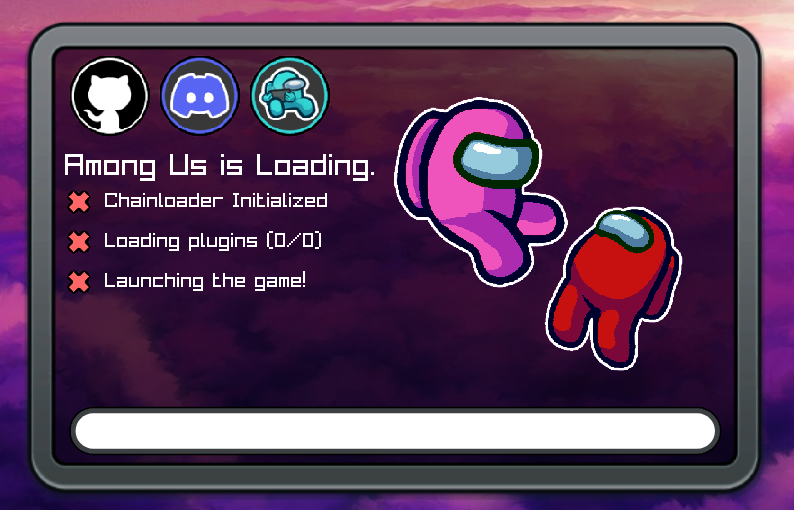

# BepInEx.SplashReimagined / ThetaHalo.BepInExSplash
A reimagining of BepInEx.SplashScreen which improves the UI.

---

| Preview  |
|:--------:|
|  |

---

### For Developers:
When shipping this with your mod, you are able to modify certain aspects of the splash screen by changing the "splash.cfg" file. \
It's highly recommended to do this, especially for the button links.\
The following options are available:

| Option        | Description                                                                                | Type   |
|---------------|--------------------------------------------------------------------------------------------|--------|
| `ProjectName` | The name of your project.                                                                  | string |
| `GameName`    | The name of the game your mod is for.                                                      | string |
| `DiscordLink` | The link to your Discord server.                                                           | string |
| `GitHubLink`  | The link to your GitHub repository or website.                                             | string |
| `LogoPath`    | The path to your project's logo.   It's recommended to put this in the assets folder. | string |
| `IconPath`    | The path to your project's icon.   It's recommended to put this in the assets folder. | string |

By default, this Splash Screen is themed to Among Us (cause i'm an among us mod developer), but it should work for any game, as long as you use `BepInEx 6`

---

### Credits:
- [Lotus.SplashScreen](https://github.com/Lotus-AU/Lotus.SplashScreen) - What this is forked from.
- [am-clonec/AchievementsAPI](https://github.com/am-clonec/AchievementsAPI) - Background for the Splash Screen.
- [BepInEx.SplashScreen](https://github.com/BepInEx/BepInEx.SplashScreen) - Original Splash Screen for BepInEx. Some code is used from there (kind of unavoidable).

**This project is licensed under the GNU General Public License v3.0. See the LICENSE file for more details.**
